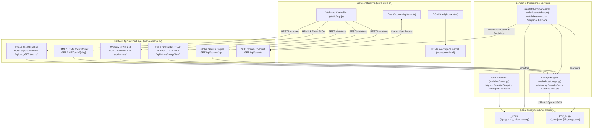
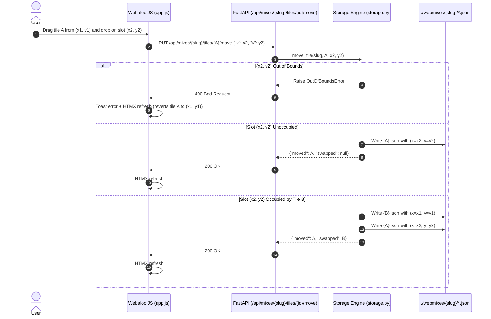
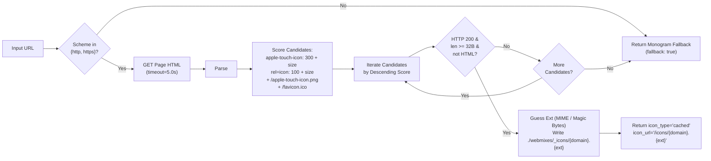
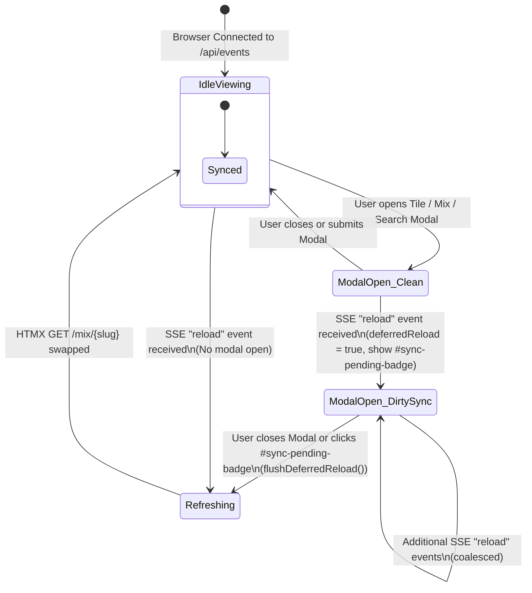

# Webaloo — Software Design & Implementation Document (SDI)

| Metadata Field | Value |
| :--- | :--- |
| **Document ID** | `WEBALOO-SDI-001` |
| **Version** | `1.0.0` |
| **Status** | `IMPLEMENTED & VERIFIED` |
| **System Class** | Local-First, Filesystem-Backed 2D Spatial Bookmark Manager |
| **Source Specs** | [Briefing.md](file:///C:/Dev/github/philippeback/webaloo/Briefing.md), [WebalooSpec.md](file:///C:/Dev/github/philippeback/webaloo/WebalooSpec.md), [WebalooEARS-Spec.md](file:///C:/Dev/github/philippeback/webaloo/WebalooEARS-Spec.md) |
| **Runtime** | Python 3.10+ (`uv`), FastAPI, Jinja2 + HTMX, Tailwind CSS, Watchfiles |

---

## 1. Architectural Axiom & System Invariants

Webaloo is governed by a strict **isomorphism between the on-disk directory hierarchy and the in-browser 2D spatial state**. There is no relational database, no WAL file, no ORM, and no opaque binary state. Every mutation in the UI is a deterministic transformation on UTF-8 JSON files, and every external mutation on disk (e.g., via VS Code or `git pull`) is projected back to the browser via Server-Sent Events (SSE).

### 1.1 Formal System Invariants (`INV-01` – `INV-08`)

| ID | Invariant Name | Formal Statement | Enforcing Component |
| :--- | :--- | :--- | :--- |
| **`INV-01`** | **Bijective Entity Mapping** | $\forall \text{ mix } M \in \text{RootDir}: M \iff \text{Subdir}(M) \land \neg\text{startsWith}(M, \{'.', '\_'\})$. Every non-hidden, non-system subdirectory is a webmix; every non-`_` `.json` file inside $M$ is a tile. | [`Storage._is_valid_mix_dir`](file:///C:/Dev/github/philippeback/webaloo/webaloo/storage.py#L126-L128), [`Storage.list_tiles`](file:///C:/Dev/github/philippeback/webaloo/webaloo/storage.py#L186-L199) |
| **`INV-02`** | **Canonical Stem Identity** | $\forall \text{ tile } T \in M: T.\text{id} \equiv \text{stem}(\text{filename}(T))$. The filename stem is the single authoritative primary key within a webmix namespace. | [`Storage._read_tile_file`](file:///C:/Dev/github/philippeback/webaloo/webaloo/storage.py#L201-L265) |
| **`INV-03`** | **Spatial Non-Collision** | $\forall T_i, T_j \in M \ (i \neq j): (T_i.x, T_i.y) \neq (T_j.x, T_j.y)$ under UI operations, and $0 \le T.x < M.\text{grid\_cols} \land 0 \le T.y < M.\text{grid\_rows}$. | [`Storage.create_tile`](file:///C:/Dev/github/philippeback/webaloo/webaloo/storage.py#L372-L426), [`Storage.move_tile`](file:///C:/Dev/github/philippeback/webaloo/webaloo/storage.py#L455-L497) |
| **`INV-04`** | **Zero-Gravity Preservation** | Empty slots $(x, y)$ remain unoccupied until explicitly targeted (`float: true` semantics). No automatic upward or leftward compaction ever occurs. | [`_build_grid_matrix`](file:///C:/Dev/github/philippeback/webaloo/webaloo/app.py#L33-L42), [`workspace.html`](file:///C:/Dev/github/philippeback/webaloo/webaloo/templates/partials/workspace.html#L90-L162) |
| **`INV-05`** | **Deterministic Serialization** | Every JSON write uses UTF-8 encoding, `ensure_ascii=False`, `indent=2`, and a trailing newline (`\n`) to guarantee minimal, human-readable Git diffs. | [`Storage._write_json`](file:///C:/Dev/github/philippeback/webaloo/webaloo/storage.py#L120-L124) |
| **`INV-06`** | **Fault-Isolated Parsing** | A corrupt or schema-invalid `{tile}.json` or `_mix.json` never aborts directory scanning; malformed tiles are logged and skipped, and missing/corrupt `_mix.json` files are self-healed with defaults. | [`Storage._load_or_create_mix_meta`](file:///C:/Dev/github/philippeback/webaloo/webaloo/storage.py#L130-L163), [`Storage._read_tile_file`](file:///C:/Dev/github/philippeback/webaloo/webaloo/storage.py#L201-L265) |
| **`INV-07`** | **Loop-Free File Sync** | Internal API writes record a monotonic timestamp (`_last_internal_write`). The file watcher suppresses echo broadcasts within the 450ms debounce window while broadcasting all genuine external modifications. | [`Storage.mark_internal_write`](file:///C:/Dev/github/philippeback/webaloo/webaloo/storage.py#L61-L64), [`FileWatcherBroadcaster._watch_loop`](file:///C:/Dev/github/philippeback/webaloo/webaloo/watcher.py#L57-L78) |
| **`INV-08`** | **Modal-Safe UI Consistency** | External SSE `reload` events never clobber an open modal form (`#tile-modal`, `#mix-modal`, `#search-modal`). Reloads are queued (`deferredReload = true`) until modal closure. | [`Webaloo.initSSE`](file:///C:/Dev/github/philippeback/webaloo/webaloo/static/app.js#L579-L595), [`Webaloo.checkFlushDeferredReload`](file:///C:/Dev/github/philippeback/webaloo/webaloo/static/app.js#L607-L611) |

---

## 2. System Topology & Component Architecture

### 2.1 High-Level Structural Decomposition



### 2.2 Module Inventory & Responsibilities

| Module Path | Primary Abstractions | Responsibility Boundary |
| :--- | :--- | :--- |
| [`webaloo/__main__.py`](file:///C:/Dev/github/philippeback/webaloo/webaloo/__main__.py) | [`parse_args`](file:///C:/Dev/github/philippeback/webaloo/webaloo/__main__.py#L12-L33), [`resolve_config`](file:///C:/Dev/github/philippeback/webaloo/webaloo/__main__.py#L36-L42), [`main`](file:///C:/Dev/github/philippeback/webaloo/webaloo/__main__.py#L45-L50) | CLI argument parsing (`--dir`, `--host`, `--port`), precedence resolution (`CLI > ENV > Default`), and Uvicorn server bootstrap. |
| [`webaloo/storage.py`](file:///C:/Dev/github/philippeback/webaloo/webaloo/storage.py) | [`Storage`](file:///C:/Dev/github/philippeback/webaloo/webaloo/storage.py#L49-L624), [`slugify`](file:///C:/Dev/github/philippeback/webaloo/webaloo/storage.py#L16-L25), [`generate_monogram`](file:///C:/Dev/github/philippeback/webaloo/webaloo/storage.py#L28-L39), [`BoardFullError`](file:///C:/Dev/github/philippeback/webaloo/webaloo/storage.py#L42-L43), [`OutOfBoundsError`](file:///C:/Dev/github/philippeback/webaloo/webaloo/storage.py#L46-L50) | Authoritative filesystem gateway. Directory initialization, self-healing metadata, CRUD for webmixes and tiles, Euclidean slot allocation, atomic coordinate swap, cross-mix transfer, and `< 2ms` tokenized search index. |
| [`webaloo/icons.py`](file:///C:/Dev/github/philippeback/webaloo/webaloo/icons.py) | [`fetch_site_icon_and_metadata`](file:///C:/Dev/github/philippeback/webaloo/webaloo/icons.py#L94-L185), [`sanitize_icon_filename`](file:///C:/Dev/github/philippeback/webaloo/webaloo/icons.py#L28-L37), [`_extract_html_metadata`](file:///C:/Dev/github/philippeback/webaloo/webaloo/icons.py#L49-L83) | Asynchronous HTTP target inspection, `<title>` & `og:title` extraction, priority-scored icon discovery (`apple-touch-icon` > sized `<link rel="icon">` > `/favicon.ico`), content-type/magic-byte extension detection, and offline monogram fallback. |
| [`webaloo/watcher.py`](file:///C:/Dev/github/philippeback/webaloo/webaloo/watcher.py) | [`FileWatcherBroadcaster`](file:///C:/Dev/github/philippeback/webaloo/webaloo/watcher.py#L14-L103) | Async pub/sub fan-out hub using `watchfiles.awatch` (with `mtime` snapshot polling fallback) to detect external filesystem modifications and notify connected browsers. |
| [`webaloo/app.py`](file:///C:/Dev/github/philippeback/webaloo/webaloo/app.py) | [`create_app`](file:///C:/Dev/github/philippeback/webaloo/webaloo/app.py#L75-L343), [`_build_grid_matrix`](file:///C:/Dev/github/philippeback/webaloo/webaloo/app.py#L33-L42) | FastAPI factory, lifespan management, dual JSON/form payload normalization, 2D matrix projection, HTMX partial negotiation, and HTTP exception translation. |
| [`webaloo/templates/`](file:///C:/Dev/github/philippeback/webaloo/webaloo/templates/index.html) | [`index.html`](file:///C:/Dev/github/philippeback/webaloo/webaloo/templates/index.html), [`partials/workspace.html`](file:///C:/Dev/github/philippeback/webaloo/webaloo/templates/partials/workspace.html) | Jinja2 server-rendered application shell, modals (Tile Editor, Webmix Editor, Command Palette, Context Menu), and HTMX-swappable active board view. |
| [`webaloo/static/`](file:///C:/Dev/github/philippeback/webaloo/webaloo/static/app.js) | [`app.js`](file:///C:/Dev/github/philippeback/webaloo/webaloo/static/app.js), [`styles.css`](file:///C:/Dev/github/philippeback/webaloo/webaloo/static/styles.css) | Client-side `Webaloo` IIFE module managing HTML5 Drag-and-Drop, live tile preview rendering, debounced URL discovery, keyboard navigation (`Ctrl+K`, `/`, `↑`/`↓`, `Enter`, `Alt+Enter`), and modal-aware SSE synchronization. |

---

## 3. Data Model, On-Disk Schemas & Normalization Rules

### 3.1 Physical Directory Taxonomy

```text
<ROOT_DIR>/                          # Resolved via: --dir > $WEBALOO_DIR > ./webmixes
├── _icons/                          # Ignored by webmix scanner (starts with '_')
│   ├── tradingview.png              # Auto-fetched site icon
│   └── my-custom-icon.svg           # Sanitized user upload
├── default/                         # Webmix slug = "default"
│   ├── _mix.json                    # Ignored by tile scanner (starts with '_')
│   ├── google.json                  # Tile ID = "google"
│   ├── tradingview.json             # Tile ID = "tradingview"
│   └── lemonade.json                # Tile ID = "lemonade"
├── trading/                         # Webmix slug = "trading"
│   ├── _mix.json
│   ├── es-futures.json
│   └── bookmap.json
└── audio-studio/                    # Webmix slug = "audio-studio"
    ├── _mix.json
    └── kvr-audio.json
```

### 3.2 Webmix Metadata Schema (`_mix.json`)

| Field | JSON Type | Constraints & Normalization Rules | Default Value |
| :--- | :--- | :--- | :--- |
| `title` | `string` | Non-empty string; defaults to title-cased directory slug if omitted. | `mix_dir.name.title()` |
| `order` | `integer` | Primary sort key in tab bar (`(order, slug)`). Re-indexed `0..N-1` on reorder. | `0` (or `max + 1`) |
| `grid_cols` | `integer` | Clamped to $1 \le \text{grid\_cols} \le 30$ (UI modal enforces $2..24$). | `12` |
| `grid_rows` | `integer` | Clamped to $1 \le \text{grid\_rows} \le 30$ (UI modal enforces $2..20$). | `8` |
| `theme` | `string` | Enum: `{"dark", "light"}`. Any invalid value normalizes to `"dark"`. | `"dark"` |
| `background` | `string` | Any valid CSS `background` property (`#hex`, `linear-gradient(...)`, `radial-gradient(...)`). | `"#0f172a"` |
| `created_at` | `string` | ISO-8601 UTC timestamp (`YYYY-MM-DDTHH:MM:SSZ`). Preserved across updates. | Current UTC time |

### 3.3 Tile Schema (`{tile_id}.json`)

| Field | JSON Type | Constraints & Normalization Rules | Default Value |
| :--- | :--- | :--- | :--- |
| `id` | `string` | Always synchronized with filename stem (`{tile_id}`). | Derived from stem |
| `name` | `string` | Display label and primary search token. | `"Bookmark"` (or stem) |
| `url` | `string` | Supports `https://`, `http://`, LAN IPs (`192.168.x.x`), `localhost`, and custom URI schemes (`vscode://`, `obsidian://`). | `"https://example.com"` |
| `x` | `integer` | Strict integer (`not isinstance(x, bool)`), $0 \le x < \text{grid\_cols}$. | Nearest free $x$ |
| `y` | `integer` | Strict integer (`not isinstance(y, bool)`), $0 \le y < \text{grid\_rows}$. | Nearest free $y$ |
| `w`, `h` | `integer` | Cell span dimensions ($w \ge 1, h \ge 1$). | `1`, `1` |
| `bg_color` | `string` | CSS hex/color string for tile surface. | `"#1e293b"` |
| `text_color` | `string` | CSS hex/color string for label and monogram/icon. | `"#ffffff"` |
| `show_label` | `boolean` | Controls whether text label renders below icon. | `true` |
| `icon_type` | `string` | Enum: `{"cached", "lucide", "external", "monogram"}`. Inferred automatically if omitted on disk. | `"monogram"` |
| `icon` | `string \| null` | Stored on disk with `"lucide:"` namespace prefix (e.g., `"lucide:candlestick-chart"`), stripped in memory for template rendering. | `null` |
| `icon_url` | `string \| null` | Local path (`/icons/{file}`) when `icon_type == "cached"`, or remote URL when `"external"`. | `null` |
| `monogram` | `string` | 1–4 uppercase characters. Auto-derived via [`generate_monogram`](file:///C:/Dev/github/philippeback/webaloo/webaloo/storage.py#L28-L39) if blank. | Auto-derived |
| `tags` | `array<string>` | Trimmed non-empty string list used by the global search index. | `[]` |
| `target` | `string` | Enum: `{"_blank", "_self"}`. | `"_blank"` |

---

## 4. Core Algorithms & State Machines

### 4.1 Slugification & Collision Resolution (`slugify` & `_unique_tile_id`)

1. **Normalization ([`slugify`](file:///C:/Dev/github/philippeback/webaloo/webaloo/storage.py#L16-L25)):**
   - Input string is lowercased and stripped.
   - Non-alphanumeric runs `[^a-z0-9]+` are collapsed to a single hyphen `-`.
   - Leading/trailing `-` and `_` are stripped.
   - If the resulting string is empty or begins with `.` or `_`, the `fallback` prefix (`"tile"` or `"mix"`) is prepended so the file/directory is never treated as hidden/system by `INV-01`.
2. **Collision Suffixing ([`Storage._unique_tile_id`](file:///C:/Dev/github/philippeback/webaloo/webaloo/storage.py#L363-L370) & [`Storage.create_mix`](file:///C:/Dev/github/philippeback/webaloo/webaloo/storage.py#L218-L252)):**
   - If `{slug}.json` does not exist in `mix_dir`, return `{slug}`.
   - Otherwise, iterate $k \in \{2, 3, 4, \dots\}$ until `{slug}-{k}.json` does not exist, guaranteeing $O(N)$ deterministic uniqueness without random UUID clutter.

### 4.2 Nearest-Slot Spatial Allocation (`_find_nearest_free_slot`)

Used when creating a tile on an occupied coordinate, duplicating a tile (`REQ-TILE-008`), transferring a tile whose coordinate is taken in the target webmix (`REQ-TILE-010`), or relocating out-of-bounds tiles during a grid shrink (`REQ-MIX-007`).

- **Input:** Occupied coordinate set $O \subseteq \mathbb{Z}^2$, bounds $(C, R)$, anchor $(x_0, y_0)$.
- **Fast Path:** If $(x_0, y_0) \notin O$ and $0 \le x_0 < C \land 0 \le y_0 < R$, return $(x_0, y_0)$ in $O(1)$.
- **Metric Search:** For every unoccupied cell $(x, y) \in [0, C) \times [0, R) \setminus O$, compute the sort tuple:
  $$k(x, y) = \left(\sqrt{(x - x_0)^2 + (y - y_0)^2},\ y,\ x\right)$$
- **Selection:** Return $(x, y)$ minimizing $k(x, y)$ (Euclidean proximity with deterministic row-major tie-breaking). If $[0, C) \times [0, R) \setminus O = \emptyset$, raise [`BoardFullError`](file:///C:/Dev/github/philippeback/webaloo/webaloo/storage.py#L42-L43).

### 4.3 Atomic Drag-to-Move & Drag-to-Swap (`Storage.move_tile`)



### 4.4 Grid Dimension Shrinking & Out-of-Bounds Relocation (`Storage.update_mix`)

When a user edits a webmix's `(grid_cols, grid_rows)` to $(C_{\text{new}}, R_{\text{new}})$:
1. Compute the out-of-bounds partition:
   $$T_{\text{oob}} = \{t \in M.\text{tiles} \mid t.x \ge C_{\text{new}} \lor t.y \ge R_{\text{new}}\}$$
2. If $T_{\text{oob}} \neq \emptyset$ and `relocate_out_of_bounds == False`:
   - Abort before touching the filesystem and raise [`OutOfBoundsError(affected_tiles=T_oob)`](file:///C:/Dev/github/philippeback/webaloo/webaloo/storage.py#L46-L50), which returns `HTTP 409 Conflict` with `"code": "OUT_OF_BOUNDS_TILES"`.
   - Note that the UI also proactively evaluates this condition client-side on input change ([`Webaloo.checkMixBoundsWarning`](file:///C:/Dev/github/philippeback/webaloo/webaloo/static/app.js#L455-L473)) to display the warning banner and relocation checkbox immediately.
3. If $T_{\text{oob}} \neq \emptyset$ and `relocate_out_of_bounds == True`:
   - Verify total capacity: if $|M.\text{tiles}| > C_{\text{new}} \times R_{\text{new}}$, raise [`BoardFullError`](file:///C:/Dev/github/philippeback/webaloo/webaloo/storage.py#L42-L43) (`HTTP 400`).
   - Initialize occupied set $O_{\text{in}} = \{(t.x, t.y) \mid t \in M.\text{tiles} \setminus T_{\text{oob}}\}$.
   - For each $t \in T_{\text{oob}}$, clamp its anchor to $(\min(t.x, C_{\text{new}}-1), \min(t.y, R_{\text{new}}-1))$, allocate the nearest free slot $(x', y') \notin O_{\text{in}}$ via `_find_nearest_free_slot`, add $(x', y')$ to $O_{\text{in}}$, and persist `{t.id}.json`.
   - Persist updated `_mix.json`.

### 4.5 Favicon & Metadata Discovery Pipeline (`fetch_site_icon_and_metadata`)



### 4.6 External File Synchronization & Modal Deferral State Machine



---

## 5. HTTP & REST API Specification

| Method | Path | Request Payload / Params | Success Status & Response | Error Codes |
| :--- | :--- | :--- | :--- | :--- |
| `GET` | `/` | — | `200 OK` (`text/html`) Full [`index.html`](file:///C:/Dev/github/philippeback/webaloo/webaloo/templates/index.html) shell loaded with first ordered webmix. | `404` if no mix exists |
| `GET` | `/mix/{mix_slug}` | `?highlight={tile_id}` (optional); Header `HX-Request: true` (optional) | `200 OK` (`text/html`) Returns [`partials/workspace.html`](file:///C:/Dev/github/philippeback/webaloo/webaloo/templates/partials/workspace.html) when `HX-Request: true`, else full [`index.html`](file:///C:/Dev/github/philippeback/webaloo/webaloo/templates/index.html). Redirects `302` to first mix if `{mix_slug}` was deleted. | `404` |
| `GET` | `/api/mixes` | — | `200 OK` `{"mixes": [...]}` | — |
| `GET` | `/api/mixes/{mix_slug}` | — | `200 OK` Webmix metadata object including `"tiles": [...]`. | `404` |
| `POST` | `/api/mixes` | `{"title": str, "slug"?: str, "grid_cols"?: int, "grid_rows"?: int, "theme"?: str, "background"?: str}` | `201 Created` Newly created webmix object. | `400` missing title; `409` explicit slug exists |
| `PUT` | `/api/mixes/reorder` | `{"order": [slug1, slug2, ...]}` | `200 OK` `{"mixes": [...]}` with updated `order` values persisted in each `_mix.json`. | `400` invalid payload |
| `PUT` | `/api/mixes/{mix_slug}` | `{"title"?: str, "grid_cols"?: int, "grid_rows"?: int, "theme"?: str, "background"?: str, "relocate_out_of_bounds"?: bool}` | `200 OK` Updated webmix object. | `404` not found; `409` `OUT_OF_BOUNDS_TILES`; `400` board too small |
| `DELETE` | `/api/mixes/{mix_slug}` | — | `200 OK` `{"deleted": mix_slug, "next_mix": str}` (auto-bootstraps `default` if last mix deleted). | `404` |
| `POST` | `/api/mixes/{mix_slug}/tiles` | Tile JSON or Form fields (`name`, `url`, `x`, `y`, `bg_color`, `text_color`, `show_label`, `icon_type`, `icon`, `icon_url`, `monogram`, `tags`, `target`) | `201 Created` Persisted tile object with unique `id`. | `404` mix not found; `400` out of bounds or full |
| `PUT` | `/api/mixes/{mix_slug}/tiles/{tile_id}` | Partial/full Tile JSON or Form fields (+ optional `new_slug`) | `200 OK` Updated tile object. | `404` not found; `400` out of bounds |
| `PUT` | `/api/mixes/{mix_slug}/tiles/{tile_id}/move` | `{"x": int, "y": int}` | `200 OK` `{"moved": Tile, "swapped": Tile \| null}`. | `400` missing/out-of-bounds coords; `404` not found |
| `POST` | `/api/mixes/{mix_slug}/tiles/{tile_id}/duplicate` | — | `201 Created` Cloned tile object placed at nearest unoccupied slot. | `404` not found; `409` board full |
| `POST` | `/api/mixes/{mix_slug}/tiles/{tile_id}/transfer` | `{"target_mix": str}` | `200 OK` Transferred tile object in destination webmix. | `400` missing target; `404` not found; `409` destination full |
| `DELETE` | `/api/mixes/{mix_slug}/tiles/{tile_id}` | — | `200 OK` `{"deleted": tile_id, "mix_slug": mix_slug}`. | `404` |
| `POST` | `/api/icons/fetch` | `{"url": str}` | `200 OK` `{"ok": bool, "title": str, "icon_type": str, "icon_url": str \| null, "monogram": str, "fallback": bool}`. | `400` missing URL |
| `POST` | `/api/icons/upload` | `multipart/form-data` with `file` (`.png`, `.svg`, `.ico`, `.webp`, `.jpg`, `.jpeg`, `.gif`) | `200 OK` `{"ok": true, "filename": str, "icon_type": "cached", "icon_url": "/icons/..."}`. | `400` invalid extension or empty file |
| `GET` | `/icons/{filename}` | — | `200 OK` Binary image stream with inferred MIME type from `./webmixes/_icons/`. | `404` (path traversal strictly blocked) |
| `GET` | `/api/search` | `?q={query}` | `200 OK` `{"query": q, "count": int, "results": [...]}` from in-memory index. | — |
| `GET` | `/api/events` | `?once=true` (optional for test probes) | `200 OK` (`text/event-stream`) Emits `event: connected`, `event: reload`, and `: keepalive` every 15s. | — |

---

## 6. Requirements Traceability Matrix (EARS $\rightarrow$ Implementation $\rightarrow$ Verification)

| EARS Requirement ID | Requirement Summary | Implementation Locus | Verification Test |
| :--- | :--- | :--- | :--- |
| **`REQ-FS-001`** | Pure filesystem persistence without SQL/NoSQL | [`Storage`](file:///C:/Dev/github/philippeback/webaloo/webaloo/storage.py#L49-L624) | [`test_req_fs_001_to_004_initialization`](file:///C:/Dev/github/philippeback/webaloo/tests/test_webaloo.py#L14-L28) |
| **`REQ-FS-002`** | Default `./webmixes` root directory | [`Storage.__init__`](file:///C:/Dev/github/philippeback/webaloo/webaloo/storage.py#L52-L59), [`resolve_config`](file:///C:/Dev/github/philippeback/webaloo/webaloo/__main__.py#L36-L42) | [`test_req_fs_001_to_004_initialization`](file:///C:/Dev/github/philippeback/webaloo/tests/test_webaloo.py#L14-L28) |
| **`REQ-FS-003`** | `--dir` > `WEBALOO_DIR` > `./webmixes` precedence | [`resolve_config`](file:///C:/Dev/github/philippeback/webaloo/webaloo/__main__.py#L36-L42) | [`test_req_fs_003_cli_and_env_precedence`](file:///C:/Dev/github/philippeback/webaloo/tests/test_webaloo.py#L31-L44) |
| **`REQ-FS-004`** | Auto-bootstrap root dir, `_icons/`, and `default/_mix.json` | [`Storage.ensure_initialized`](file:///C:/Dev/github/philippeback/webaloo/webaloo/storage.py#L70-L99) | [`test_req_fs_001_to_004_initialization`](file:///C:/Dev/github/philippeback/webaloo/tests/test_webaloo.py#L14-L28) |
| **`REQ-FS-005`** | Subdirectories not starting with `.` or `_` are webmixes | [`Storage._is_valid_mix_dir`](file:///C:/Dev/github/philippeback/webaloo/webaloo/storage.py#L126-L128) | [`test_req_fs_005_to_011_scanning_and_resilience`](file:///C:/Dev/github/philippeback/webaloo/tests/test_webaloo.py#L47-L82) |
| **`REQ-FS-006`** | `_mix.json` stores `title`, `order`, `grid_cols`, `grid_rows`, `theme`, `background`, `created_at` | [`Storage._default_mix_metadata`](file:///C:/Dev/github/philippeback/webaloo/webaloo/storage.py#L101-L118) | [`test_req_fs_001_to_004_initialization`](file:///C:/Dev/github/philippeback/webaloo/tests/test_webaloo.py#L14-L28) |
| **`REQ-FS-007`** | Non-`_` `.json` files in webmix folder are tiles | [`Storage.list_tiles`](file:///C:/Dev/github/philippeback/webaloo/webaloo/storage.py#L186-L199) | [`test_req_fs_005_to_011_scanning_and_resilience`](file:///C:/Dev/github/philippeback/webaloo/tests/test_webaloo.py#L47-L82) |
| **`REQ-FS-008`** | Tile `id` derived from filename stem | [`Storage._read_tile_file`](file:///C:/Dev/github/philippeback/webaloo/webaloo/storage.py#L201-L265) | [`test_req_fs_005_to_011_scanning_and_resilience`](file:///C:/Dev/github/philippeback/webaloo/tests/test_webaloo.py#L47-L82) |
| **`REQ-FS-009`** | UTF-8 serialization with 2-space indentation | [`Storage._write_json`](file:///C:/Dev/github/philippeback/webaloo/webaloo/storage.py#L120-L124) | [`test_req_mix_and_grid_and_tile_api_lifecycle`](file:///C:/Dev/github/philippeback/webaloo/tests/test_webaloo.py#L85-L249) |
| **`REQ-FS-010`** | Missing `_mix.json` auto-generated with `12×8` defaults | [`Storage._load_or_create_mix_meta`](file:///C:/Dev/github/philippeback/webaloo/webaloo/storage.py#L130-L163) | [`test_req_fs_005_to_011_scanning_and_resilience`](file:///C:/Dev/github/philippeback/webaloo/tests/test_webaloo.py#L47-L82) |
| **`REQ-FS-011`** | Malformed tile JSON logged & skipped without crashing | [`Storage._read_tile_file`](file:///C:/Dev/github/philippeback/webaloo/webaloo/storage.py#L201-L265) | [`test_req_fs_005_to_011_scanning_and_resilience`](file:///C:/Dev/github/philippeback/webaloo/tests/test_webaloo.py#L47-L82) |
| **`REQ-MIX-001`** | Top tab bar sorted ascending by `order` | [`Storage.list_mixes`](file:///C:/Dev/github/philippeback/webaloo/webaloo/storage.py#L165-L176), [`workspace.html`](file:///C:/Dev/github/philippeback/webaloo/webaloo/templates/partials/workspace.html#L24-L53) | [`test_req_mix_and_grid_and_tile_api_lifecycle`](file:///C:/Dev/github/philippeback/webaloo/tests/test_webaloo.py#L85-L249) |
| **`REQ-MIX-002`** | Tab click switches board via HTMX + updates URL | [`view_mix`](file:///C:/Dev/github/philippeback/webaloo/webaloo/app.py#L118-L138), [`workspace.html`](file:///C:/Dev/github/philippeback/webaloo/webaloo/templates/partials/workspace.html#L38-L44) | [`test_req_mix_and_grid_and_tile_api_lifecycle`](file:///C:/Dev/github/philippeback/webaloo/tests/test_webaloo.py#L85-L249) |
| **`REQ-MIX-003`** | Create webmix slugifies title and writes `_mix.json` | [`Storage.create_mix`](file:///C:/Dev/github/philippeback/webaloo/webaloo/storage.py#L218-L252) | [`test_req_mix_and_grid_and_tile_api_lifecycle`](file:///C:/Dev/github/philippeback/webaloo/tests/test_webaloo.py#L85-L249) |
| **`REQ-MIX-004`** | Duplicate webmix slug appends suffix or returns 409 | [`Storage.create_mix`](file:///C:/Dev/github/philippeback/webaloo/webaloo/storage.py#L225-L234) | [`test_req_mix_and_grid_and_tile_api_lifecycle`](file:///C:/Dev/github/philippeback/webaloo/tests/test_webaloo.py#L85-L249) |
| **`REQ-MIX-005`** | Drag-and-drop tab reorder persists `order` | [`Storage.reorder_mixes`](file:///C:/Dev/github/philippeback/webaloo/webaloo/storage.py#L317-L343), [`Webaloo.onTabDrop`](file:///C:/Dev/github/philippeback/webaloo/webaloo/static/app.js#L161-L186) | [`test_req_mix_and_grid_and_tile_api_lifecycle`](file:///C:/Dev/github/philippeback/webaloo/tests/test_webaloo.py#L85-L249) |
| **`REQ-MIX-006`** | Edit webmix updates metadata and re-renders | [`Storage.update_mix`](file:///C:/Dev/github/philippeback/webaloo/webaloo/storage.py#L254-L315) | [`test_req_mix_and_grid_and_tile_api_lifecycle`](file:///C:/Dev/github/philippeback/webaloo/tests/test_webaloo.py#L85-L249) |
| **`REQ-MIX-007`** | Shrinking grid warns & relocates out-of-bounds tiles | [`Storage.update_mix`](file:///C:/Dev/github/philippeback/webaloo/webaloo/storage.py#L271-L303), [`Webaloo.checkMixBoundsWarning`](file:///C:/Dev/github/philippeback/webaloo/webaloo/static/app.js#L455-L473) | [`test_req_mix_and_grid_and_tile_api_lifecycle`](file:///C:/Dev/github/philippeback/webaloo/tests/test_webaloo.py#L85-L249) |
| **`REQ-MIX-008`** | Delete webmix removes folder while keeping `_icons/` | [`Storage.delete_mix`](file:///C:/Dev/github/philippeback/webaloo/webaloo/storage.py#L345-L352) | [`test_req_mix_and_grid_and_tile_api_lifecycle`](file:///C:/Dev/github/philippeback/webaloo/tests/test_webaloo.py#L85-L249) |
| **`REQ-GRID-001`** | Fixed `grid_cols × grid_rows` 2D spatial matrix | [`_build_grid_matrix`](file:///C:/Dev/github/philippeback/webaloo/webaloo/app.py#L33-L42), [`workspace.html`](file:///C:/Dev/github/philippeback/webaloo/webaloo/templates/partials/workspace.html#L91-L97) | [`test_req_mix_and_grid_and_tile_api_lifecycle`](file:///C:/Dev/github/philippeback/webaloo/tests/test_webaloo.py#L85-L249) |
| **`REQ-GRID-002`** | Preserve empty slots (`float: true`, no auto-pack) | [`workspace.html`](file:///C:/Dev/github/philippeback/webaloo/webaloo/templates/partials/workspace.html#L96-L161) | [`test_req_mix_and_grid_and_tile_api_lifecycle`](file:///C:/Dev/github/philippeback/webaloo/tests/test_webaloo.py#L85-L249) |
| **`REQ-GRID-003`** | Interactive empty cell placeholders with hover state | [`workspace.html`](file:///C:/Dev/github/philippeback/webaloo/webaloo/templates/partials/workspace.html#L150-L159) | [`test_req_mix_and_grid_and_tile_api_lifecycle`](file:///C:/Dev/github/philippeback/webaloo/tests/test_webaloo.py#L85-L249) |
| **`REQ-GRID-004`** | Drag tile to empty cell updates `(x, y)` on disk | [`Storage.move_tile`](file:///C:/Dev/github/philippeback/webaloo/webaloo/storage.py#L455-L497) | [`test_req_mix_and_grid_and_tile_api_lifecycle`](file:///C:/Dev/github/philippeback/webaloo/tests/test_webaloo.py#L85-L249) |
| **`REQ-GRID-005`** | Drag tile to occupied cell atomically swaps both tiles | [`Storage.move_tile`](file:///C:/Dev/github/philippeback/webaloo/webaloo/storage.py#L477-L496) | [`test_req_mix_and_grid_and_tile_api_lifecycle`](file:///C:/Dev/github/philippeback/webaloo/tests/test_webaloo.py#L85-L249) |
| **`REQ-GRID-006`** | Failed/out-of-bounds move reverts UI & notifies user | [`Storage.move_tile`](file:///C:/Dev/github/philippeback/webaloo/webaloo/storage.py#L462-L466), [`Webaloo.onSlotDrop`](file:///C:/Dev/github/philippeback/webaloo/webaloo/static/app.js#L106-L135) | [`test_req_mix_and_grid_and_tile_api_lifecycle`](file:///C:/Dev/github/philippeback/webaloo/tests/test_webaloo.py#L85-L249) |
| **`REQ-TILE-001`** | Left-click occupied tile opens URL with `target` | [`workspace.html`](file:///C:/Dev/github/philippeback/webaloo/webaloo/templates/partials/workspace.html#L112-L119) | [`test_req_mix_and_grid_and_tile_api_lifecycle`](file:///C:/Dev/github/philippeback/webaloo/tests/test_webaloo.py#L85-L249) |
| **`REQ-TILE-002`** | Support HTTPS, HTTP, localhost, LAN IPs, custom URIs | [`Storage.create_tile`](file:///C:/Dev/github/philippeback/webaloo/webaloo/storage.py#L372-L426) | [`test_req_mix_and_grid_and_tile_api_lifecycle`](file:///C:/Dev/github/philippeback/webaloo/tests/test_webaloo.py#L85-L249) |
| **`REQ-TILE-003`** | Left-click empty cell opens Create Tile at `(x, y)` | [`Webaloo.openCreateTileModal`](file:///C:/Dev/github/philippeback/webaloo/webaloo/static/app.js#L266-L288) | Manual & DOM inspection |
| **`REQ-TILE-004`** | Slugified filename generated from tile `name` | [`Storage.create_tile`](file:///C:/Dev/github/philippeback/webaloo/webaloo/storage.py#L403-L406) | [`test_req_mix_and_grid_and_tile_api_lifecycle`](file:///C:/Dev/github/philippeback/webaloo/tests/test_webaloo.py#L85-L249) |
| **`REQ-TILE-005`** | Colliding tile stem appends `-2`, `-3`, ... | [`Storage._unique_tile_id`](file:///C:/Dev/github/philippeback/webaloo/webaloo/storage.py#L363-L370) | [`test_req_mix_and_grid_and_tile_api_lifecycle`](file:///C:/Dev/github/philippeback/webaloo/tests/test_webaloo.py#L85-L249) |
| **`REQ-TILE-006`** | Right-click / hover button opens tile context menu | [`Webaloo.showContextMenu`](file:///C:/Dev/github/philippeback/webaloo/webaloo/static/app.js#L204-L231) | Manual & DOM inspection |
| **`REQ-TILE-007`** | Edit tile updates JSON file and refreshes grid | [`Storage.update_tile`](file:///C:/Dev/github/philippeback/webaloo/webaloo/storage.py#L428-L453) | [`test_req_mix_and_grid_and_tile_api_lifecycle`](file:///C:/Dev/github/philippeback/webaloo/tests/test_webaloo.py#L85-L249) |
| **`REQ-TILE-008`** | Duplicate tile clones into nearest unoccupied slot | [`Storage.duplicate_tile`](file:///C:/Dev/github/philippeback/webaloo/webaloo/storage.py#L499-L519) | [`test_req_mix_and_grid_and_tile_api_lifecycle`](file:///C:/Dev/github/philippeback/webaloo/tests/test_webaloo.py#L85-L249) |
| **`REQ-TILE-009`** | Duplicate on full board rejected with `409 Conflict` | [`Storage.duplicate_tile`](file:///C:/Dev/github/philippeback/webaloo/webaloo/storage.py#L510-L511) | [`test_req_tile_009_duplicate_on_full_board`](file:///C:/Dev/github/philippeback/webaloo/tests/test_webaloo.py#L252-L261) |
| **`REQ-TILE-010`** | Transfer tile moves JSON file to target webmix | [`Storage.transfer_tile`](file:///C:/Dev/github/philippeback/webaloo/webaloo/storage.py#L521-L567) | [`test_req_mix_and_grid_and_tile_api_lifecycle`](file:///C:/Dev/github/philippeback/webaloo/tests/test_webaloo.py#L85-L249) |
| **`REQ-TILE-011`** | Delete tile unlinks `{tile_id}.json` from disk | [`Storage.delete_tile`](file:///C:/Dev/github/philippeback/webaloo/webaloo/storage.py#L569-L578) | [`test_req_mix_and_grid_and_tile_api_lifecycle`](file:///C:/Dev/github/philippeback/webaloo/tests/test_webaloo.py#L85-L249) |
| **`REQ-ICON-001`** | Icons stored in `./webmixes/_icons/` & served at `/icons/*` | [`serve_cached_icon`](file:///C:/Dev/github/philippeback/webaloo/webaloo/app.py#L298-L303) | [`test_req_mix_and_grid_and_tile_api_lifecycle`](file:///C:/Dev/github/philippeback/webaloo/tests/test_webaloo.py#L85-L249) |
| **`REQ-ICON-002`** | `POST /api/icons/fetch` extracts page title & best icon | [`fetch_site_icon_and_metadata`](file:///C:/Dev/github/philippeback/webaloo/webaloo/icons.py#L94-L185) | [`test_req_mix_and_grid_and_tile_api_lifecycle`](file:///C:/Dev/github/philippeback/webaloo/tests/test_webaloo.py#L85-L249) |
| **`REQ-ICON-003`** | Network/TLS failure falls back to styled monogram | [`fetch_site_icon_and_metadata`](file:///C:/Dev/github/philippeback/webaloo/webaloo/icons.py#L176-L185) | [`test_req_mix_and_grid_and_tile_api_lifecycle`](file:///C:/Dev/github/philippeback/webaloo/tests/test_webaloo.py#L85-L249) |
| **`REQ-ICON-004`** | Four selectable icon modes (`cached`, `lucide`, `external`, `monogram`) | [`index.html`](file:///C:/Dev/github/philippeback/webaloo/webaloo/templates/index.html#L140-L208), [`Webaloo.setIconMode`](file:///C:/Dev/github/philippeback/webaloo/webaloo/static/app.js#L341-L350) | [`test_req_mix_and_grid_and_tile_api_lifecycle`](file:///C:/Dev/github/philippeback/webaloo/tests/test_webaloo.py#L85-L249) |
| **`REQ-ICON-005`** | Custom icon upload sanitizes filename into `_icons/` | [`sanitize_icon_filename`](file:///C:/Dev/github/philippeback/webaloo/webaloo/icons.py#L28-L37), [`api_upload_icon`](file:///C:/Dev/github/philippeback/webaloo/webaloo/app.py#L274-L296) | [`test_req_mix_and_grid_and_tile_api_lifecycle`](file:///C:/Dev/github/philippeback/webaloo/tests/test_webaloo.py#L85-L249) |
| **`REQ-ICON-006`** | Live tile preview for colors, label toggle, and icons | [`Webaloo.updateTilePreview`](file:///C:/Dev/github/philippeback/webaloo/webaloo/static/app.js#L379-L424) | Manual & DOM inspection |
| **`REQ-SRCH-001`** | `Ctrl+K`, `/`, or search button opens command palette | [`app.js` keydown listener](file:///C:/Dev/github/philippeback/webaloo/webaloo/static/app.js#L614-L633) | Manual & DOM inspection |
| **`REQ-SRCH-002`** | Instant tokenized search across `name`, `url`, `tags`, `mix_title` | [`Storage.search`](file:///C:/Dev/github/philippeback/webaloo/webaloo/storage.py#L611-L624) | [`test_req_mix_and_grid_and_tile_api_lifecycle`](file:///C:/Dev/github/philippeback/webaloo/tests/test_webaloo.py#L85-L249) |
| **`REQ-SRCH-003`** | `↑`/`↓` navigation, `Enter` open URL, `Alt+Enter` jump & highlight | [`Webaloo.onSearchKeyDown`](file:///C:/Dev/github/philippeback/webaloo/webaloo/static/app.js#L557-L576) | Manual & DOM inspection |
| **`REQ-SYNC-001`** | Continuous background monitoring of `./webmixes` | [`FileWatcherBroadcaster`](file:///C:/Dev/github/philippeback/webaloo/webaloo/watcher.py#L14-L103) | Implemented in [`watcher.py`](file:///C:/Dev/github/philippeback/webaloo/webaloo/watcher.py) |
| **`REQ-SYNC-002`** | External file change invalidates search cache & emits SSE `reload` | [`FileWatcherBroadcaster.broadcast`](file:///C:/Dev/github/philippeback/webaloo/webaloo/watcher.py#L31-L42) | Implemented in [`watcher.py`](file:///C:/Dev/github/philippeback/webaloo/webaloo/watcher.py) |
| **`REQ-SYNC-003`** | Browser refreshes grid & tabs via HTMX when no modal is open | [`Webaloo.initSSE`](file:///C:/Dev/github/philippeback/webaloo/webaloo/static/app.js#L579-L595) | Implemented in [`app.js`](file:///C:/Dev/github/philippeback/webaloo/webaloo/static/app.js) |
| **`REQ-SYNC-004`** | Defer SSE reload while modal is open & display sync indicator | [`Webaloo.initSSE`](file:///C:/Dev/github/philippeback/webaloo/webaloo/static/app.js#L583-L591), [`Webaloo.flushDeferredReload`](file:///C:/Dev/github/philippeback/webaloo/webaloo/static/app.js#L597-L605) | Implemented in [`app.js`](file:///C:/Dev/github/philippeback/webaloo/webaloo/static/app.js) |

---

## 7. Security, Resilience & Operational Boundaries

1. **Path Traversal Prevention:**
   - Every dynamic path lookup (`mix_slug`, `tile_id`, `filename` in `/icons/{filename}`) resolves the candidate path via `.resolve()` and asserts `resolved_path.parent == expected_parent_dir` ([`Storage.get_mix`](file:///C:/Dev/github/philippeback/webaloo/webaloo/storage.py#L178-L184), [`Storage.get_tile`](file:///C:/Dev/github/philippeback/webaloo/webaloo/storage.py#L298-L305), [`serve_cached_icon`](file:///C:/Dev/github/philippeback/webaloo/webaloo/app.py#L298-L303)). Any `../` traversal sequence is rejected with `404 Not Found`.
2. **Upload Sanitization:**
   - Uploaded icon filenames are stripped of directory components, slugified via [`sanitize_icon_filename`](file:///C:/Dev/github/philippeback/webaloo/webaloo/icons.py#L28-L37), and restricted to `ALLOWED_ICON_EXTENSIONS = {".png", ".svg", ".ico", ".webp", ".jpg", ".jpeg", ".gif"}`.
3. **Zero-Downtime Self-Healing:**
   - Deleting all webmixes via API or disk automatically re-initializes `default/_mix.json` via [`Storage.ensure_initialized`](file:///C:/Dev/github/philippeback/webaloo/webaloo/storage.py#L70-L99) so the UI always has a valid root board to render.
   - Hand-crafted JSON files with missing optional keys (`w`, `h`, `bg_color`, `text_color`, `show_label`, `icon_type`, `monogram`, `tags`, `target`) are hydrated with deterministic defaults at read time without requiring migration scripts.
