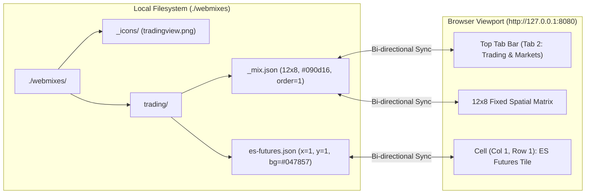

# Webaloo — Hyper-Systemized User & Operations Guide

| Metadata Field | Value |
| :--- | :--- |
| **Document ID** | `WEBALOO-UG-001` |
| **Version** | `1.0.1` |
| **Target Audience** | Power Users, Developers, System Administrators |
| **Companion Docs** | [README.md](file:///C:/Dev/github/philippeback/webaloo/README.md), [WebalooSpec.md](file:///C:/Dev/github/philippeback/webaloo/WebalooSpec.md), [WebalooEARS-Spec.md](file:///C:/Dev/github/philippeback/webaloo/WebalooEARS-Spec.md), [sdi.md](file:///C:/Dev/github/philippeback/webaloo/sdi.md) |

---

## 1. Operational Mental Model

Webaloo eliminates opaque browser bookmark databases and cloud lock-in by enforcing a **strict 1-to-1 mapping between your local filesystem and a 2D spatial grid**:



### 1.1 Core Entity Mapping

| UI Concept | Filesystem Representation | Identity Rule | Persistence Behavior |
| :--- | :--- | :--- | :--- |
| **Data Root** | `./webmixes/` (or `--dir` / `WEBALOO_DIR`) | Absolute path on disk | Created automatically on first startup if absent. |
| **Icon Cache** | `./webmixes/_icons/*` | Sanitized filename (`{slug}.{ext}`) | Shared across all webmixes; preserved even when a webmix is deleted. |
| **Webmix (Board)** | `./webmixes/{mix_slug}/` | Directory name (not starting with `.` or `_`) | Configured by `{mix_slug}/_mix.json`. Auto-healed if `_mix.json` is deleted. |
| **Tile (Bookmark)** | `./webmixes/{mix_slug}/{tile_id}.json` | Filename stem (`{tile_id}`) | Formatted with 2-space UTF-8 indentation for clean Git diffs. |
| **Empty Grid Slot** | Absence of tile with `(x, y)` in `{mix_slug}/` | Coordinate pair `(x, y)` | Preserved indefinitely (`float: true`); tiles never auto-compact. |

---

## 2. Installation, Startup & Configuration Precedence

### 2.1 Environment Setup (`uv`)

```powershell
# Clone and synchronize the environment via uv
git clone https://github.com/philippeback/webaloo.git
cd webaloo
uv sync
```

### 2.2 Runtime Execution Matrix

| Execution Scenario | Command | Resulting Configuration |
| :--- | :--- | :--- |
| **Standard Local Run** | `uv run python -m webaloo` | Root: `./webmixes`, Bind: `127.0.0.1:8080` |
| **Installed Entrypoint** | `uv run webaloo` | Root: `./webmixes`, Bind: `127.0.0.1:8080` |
| **Custom Data Directory** | `uv run webaloo --dir D:/bookmarks/webmixes` | Root: `D:\bookmarks\webmixes`, Bind: `127.0.0.1:8080` |
| **Custom Port & LAN Bind** | `uv run webaloo --host 0.0.0.0 --port 8765` | Accessible across local LAN at `http://<LAN_IP>:8765` |
| **Environment Variable Driven** | `WEBALOO_DIR="D:/mixes" WEBALOO_PORT="9000" uv run webaloo` | Root: `D:\mixes`, Bind: `127.0.0.1:9000` |

### 2.3 Configuration Precedence Hierarchy

Webaloo resolves configuration deterministically in [`resolve_config`](file:///C:/Dev/github/philippeback/webaloo/webaloo/__main__.py#L36-L42) using strict three-tier precedence:

```text
Tier 1: CLI Flag (--dir, --host, --port)  ≻  Tier 2: Environment Variable (WEBALOO_*)  ≻  Tier 3: Built-in Default
```

| Parameter | Tier 1: CLI Flag | Tier 2: Environment Variable | Tier 3: Built-in Default |
| :--- | :--- | :--- | :--- |
| **Root Data Path** | `--dir <PATH>` | `WEBALOO_DIR` | `./webmixes` |
| **Bind Address** | `--host <IP>` | `WEBALOO_HOST` | `127.0.0.1` |
| **Bind Port** | `--port <INT>` | `WEBALOO_PORT` | `8080` |

---

## 3. Complete Interaction & Gesture Taxonomy

### 3.1 Keyboard Shortcut Matrix

| Shortcut | Scope | Action |
| :--- | :--- | :--- |
| `Ctrl+K` (or `Cmd+K`) | Global (Anywhere) | Opens the **Global Instant Search** command palette and focuses the query input. |
| `/` | Global (When not typing in an input) | Opens the **Global Instant Search** command palette. |
| `↑` / `↓` | Global Search Modal | Moves selection highlight across matching tiles (wraps around top/bottom). |
| `Enter` | Global Search Modal | Opens the currently highlighted tile's URL (respecting `_blank` / `_self`). |
| `Alt+Enter` | Global Search Modal | Switches the active workspace to the highlighted tile's webmix and bounces/highlights the tile in its `(x, y)` slot. |
| `Escape` | Any Modal / Context Menu | Closes the active context menu, Search Palette, Tile Editor, or Webmix Editor modal (and flushes any deferred disk-sync reload). |

### 3.2 Spatial Grid Mouse & Drag Operations

| Target Element | Gesture | System Response | On-Disk Effect |
| :--- | :--- | :--- | :--- |
| **Occupied Tile** | **Left-Click** | Navigates immediately to `tile.url` (`_blank` new tab by default, or `_self`). | Read-only (no write). |
| **Empty Grid Cell `(x, y)`** | **Left-Click** | Opens **Create Tile** modal with coordinates pre-locked to `(x, y)`. | Writes `{slug}.json` upon form submission. |
| **Occupied Tile at `(x1, y1)`** | **Drag & Drop onto Empty `(x2, y2)`** | Moves tile smoothly to `(x2, y2)`. | Updates `"x": x2, "y": y2` in `{tile_id}.json`. |
| **Occupied Tile `A` at `(x1, y1)`** | **Drag & Drop onto Occupied `B` at `(x2, y2)`** | **Atomic Swap:** Tile `A` takes `(x2, y2)` and Tile `B` takes `(x1, y1)`. | Rewrites both `{A}.json` and `{B}.json` atomically. |
| **Occupied Tile** | **Right-Click** (or click top-right `•••` button) | Opens the floating **Tile Context Menu** (`Edit`, `Duplicate`, `Move to Webmix`, `Delete`). | Depends on selected menu command. |
| **Webmix Tab** (Top Bar) | **Left-Click** | Swaps the active grid via HTMX (`GET /mix/{slug}`) and updates browser URL. | Read-only. |
| **Webmix Tab** (Top Bar) | **Drag & Drop onto Another Tab** | Reorders tabs horizontally in the navigation bar. | Re-indexes `"order": 0..N-1` across affected `_mix.json` files. |

---

## 4. Workflows & Feature Procedures

### 4.1 Creating & Styling a Tile (The 4 Icon Modes)

1. Click any empty grid slot `(x, y)` to open the **Create Tile** modal.
2. **Enter Destination URL:**
   - Paste any URL into **Destination URL**:
     - Public web: `https://www.tradingview.com/chart/`
     - Localhost service: `http://localhost:8001/#/`
     - Private LAN appliance: `http://192.168.1.50:8888`
     - Desktop URI protocol: `obsidian://open?vault=Notes` or `vscode://file/C:/Dev/project`
   - For `http://` and `https://` URLs, Webaloo automatically triggers a debounced lookup (`POST /api/icons/fetch`) after `650ms` (or immediately when clicking **Fetch**).
   - If the target page is reachable, Webaloo populates **Tile Name** from the page's `<title>` and caches the highest-resolution `apple-touch-icon` or favicon in `./webmixes/_icons/`.
   - If the target is offline or on an isolated LAN without a favicon, Webaloo automatically falls back to a 2–4 letter **Monogram** badge without blocking creation.
3. **Select an Icon Mode:**
   - **Site / Upload (`cached`):** Uses the auto-fetched icon in `/icons/...` or lets you click **Upload Image** to store a custom `.png`, `.svg`, `.ico`, `.webp`, or `.jpg` inside `./webmixes/_icons/`.
   - **Lucide Icon (`lucide`):** Filter and click any built-in crisp vector icon (e.g., `candlestick-chart`, `terminal`, `server`, `headphones`, `cpu`).
   - **Image URL (`external`):** Renders an external image URL directly without local caching.
   - **Monogram (`monogram`):** Displays 1–4 bold uppercase characters (e.g., `TV`, `ES`, `KVR`, `NAS`).
4. **Customize Surface & Metadata:**
   - Pick **Tile Background Color** (via color picker, hex input, or quick swatches), **Text Color**, and toggle **Show label**.
   - Add comma-separated **Tags** (e.g., `trading, futures, cme`) to make the tile discoverable by keyword in `Ctrl+K`.
   - Verify the appearance in the **Live Preview** card on the left, then click **Save Tile**.

### 4.2 Context Menu Tile Operations

Right-click any occupied tile (or click its hover `•••` button) to execute:
- **Edit Tile:** Opens the Tile Editor modal hydrated with the tile's JSON payload.
- **Duplicate Tile:** Clones the tile into the nearest unoccupied `(x, y)` cell (measured by Euclidean distance from the source tile) with an auto-incremented filename stem (e.g., `tradingview-2.json`).
- **Move to Webmix:** Opens a flyout submenu listing all other webmixes. Clicking a destination webmix moves the `.json` file into that webmix directory—preserving its `(x, y)` coordinate if free in the destination board, or placing it in the first available free slot.
- **Delete Tile:** Immediately removes `{tile_id}.json` from disk and returns the `(x, y)` cell to an interactive empty slot.

### 4.3 Managing Webmixes & Resizing Grids Safely

1. **Create a Webmix:**
   - Click **+ New Mix** in the top tab bar.
   - Specify **Webmix Title**, optional **Folder Slug**, **Columns (Width)**, **Rows (Height)**, **Theme**, and **Backdrop CSS / Color** (solid hex or CSS `linear-gradient` / `radial-gradient` presets).
2. **Edit Webmix & Out-of-Bounds Protection:**
   - Click the sliders icon (`⚙️`) on the active tab or top-right header.
   - If you reduce **Columns** or **Rows** such that existing tiles have coordinates `x ≥ new_cols` or `y ≥ new_rows`, an amber warning banner immediately lists the affected tiles:
     > *"N tile(s) lie outside Cols×Rows: TileName (x,y)"*
   - Check **"Automatically relocate out-of-bounds tiles to nearest free slots"** before clicking **Save Webmix** to have Webaloo non-destructively pack those tiles into the nearest open cells inside the new boundary.

---

## 5. Direct Filesystem, VS Code & Git Workflows

Because the filesystem is the single source of truth, you can manage Webaloo entirely from your terminal or editor while the server is running.

### 5.1 Hand-Crafting a Minimal Tile in VS Code

You do not need to write all 15 JSON keys by hand. Webaloo hydrates all optional fields with sensible defaults at read time. The **minimal valid tile JSON** requires only integer `x` and `y` coordinates:

```json
{
  "name": "Local Grafana",
  "url": "http://192.168.1.10:3000",
  "x": 4,
  "y": 0
}
```

Save this file as `./webmixes/default/grafana.json`. Within ~300ms:
1. `FileWatcherBroadcaster` detects the file creation.
2. The in-memory search index is rebuilt.
3. An SSE `reload` event is pushed to the browser.
4. Your browser automatically renders the new **Local Grafana** tile at column 4, row 0 (or, if you currently have a modal open, illuminates the amber **Disk updated** badge in the top bar until you close the modal).

### 5.2 Complete Reference Schemas

#### Full Tile JSON (`./webmixes/{mix_slug}/{tile_id}.json`)
```json
{
  "id": "tradingview",
  "name": "TradingView",
  "url": "https://www.tradingview.com/chart/",
  "x": 3,
  "y": 2,
  "w": 1,
  "h": 1,
  "bg_color": "#131722",
  "text_color": "#ffffff",
  "show_label": true,
  "icon_type": "lucide",
  "icon": "lucide:candlestick-chart",
  "icon_url": null,
  "monogram": "TV",
  "tags": [
    "trading",
    "market"
  ],
  "target": "_blank"
}
```

#### Full Webmix Metadata JSON (`./webmixes/{mix_slug}/_mix.json`)
```json
{
  "title": "Trading & Markets",
  "order": 1,
  "grid_cols": 12,
  "grid_rows": 8,
  "theme": "dark",
  "background": "#090d16",
  "created_at": "2026-10-18T20:50:00Z"
}
```

### 5.3 Git Version Control & Multi-Machine Synchronization

Your `./webmixes` folder (including `./webmixes/_icons`) is 100% self-contained and portable:
- **Diffability:** All JSON writes are formatted with 2-space indentation and deterministic key order, so moving a tile produces a 2-line Git diff (`"x"` and `"y"`).
- **Live `git pull` Sync:** Running `git pull` or `rsync` inside `./webmixes` while Webaloo is open in your browser automatically refreshes your tabs and grid via SSE without restarting the Python process.

---

## 6. Diagnostic & Self-Healing Matrix

| Symptom / Condition | Root Cause | Automatic System Response / Remediation |
| :--- | :--- | :--- |
| You create a new folder `./webmixes/devops/` in Explorer/Finder without a `_mix.json` | Missing metadata file | **Self-Healed (`REQ-FS-010`):** On the next scan, Webaloo automatically creates `./webmixes/devops/_mix.json` with `"title": "Devops"` and `12×8` dimensions. |
| A tile `.json` file has a syntax error while you are editing it in VS Code | Malformed JSON or non-integer `x`/`y` | **Fault-Isolated (`REQ-FS-011`):** Webaloo logs a warning and skips only that file; the rest of the board renders normally. Once you fix and save the JSON, it reappears automatically. |
| External disk edit occurs while you are typing inside the **Create/Edit Tile** modal | Concurrent external file change | **Modal Protection (`REQ-SYNC-004`):** Webaloo defers the grid refresh so your unsaved form input is never lost, showing an amber **Disk updated** pill in the header. Closing the modal flushes the update. |
| All webmix folders inside `./webmixes` are deleted | Empty root data directory | **Self-Healed (`REQ-FS-004`):** Webaloo automatically recreates `./webmixes/default/_mix.json` so the UI always has a valid board. |
| Duplicate tile fails with a toast error | All `grid_cols × grid_rows` slots are occupied | Open **Edit Webmix** (`⚙️`) and increase **Columns** or **Rows**, or move/delete an unneeded tile. |
