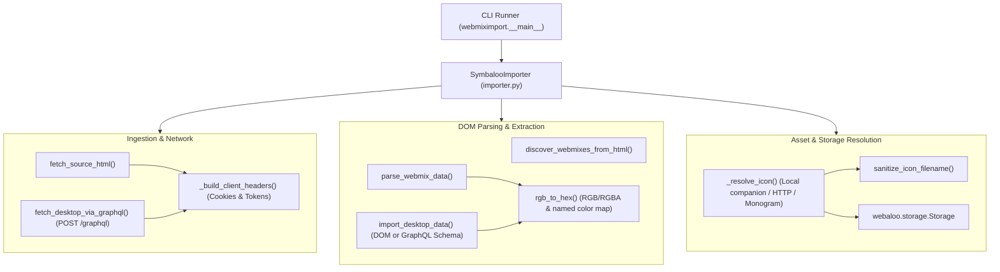

# webmiximport — Software Design & Implementation Document (SDI)

| Metadata Field | Value |
| :--- | :--- |
| **Document ID** | `WEBMIXIMPORT-SDI-001` |
| **Version** | `1.0.0` |
| **Status** | `IMPLEMENTED & VERIFIED` |
| **System Class** | Webmix ETL (Extract, Transform, Load) & Asset Ingestion Engine |
| **Source Specs** | [symbaloo-importer-spec.md](symbaloo-importer-spec.md), [sdi.md](sdi.md) |
| **Runtime** | Python 3.10+ (`uv`), BeautifulSoup4, HTTPX, Storage Subsystem |

---

## 1. Architectural Principles & Invariants

`webmiximport` transforms semi-structured Symbaloo webmix presentations (HTML DOM tree or HTTP payloads) into Webaloo's local-first, filesystem-backed JSON schema.

### 1.1 Invariants

| ID | Invariant Name | Definition | Enforcement |
| :--- | :--- | :--- | :--- |
| **`IMP-INV-01`** | **Deterministic Spatial Mapping** | Symbaloo CSS 1-based coordinates `grid-area: r / c` map bijectively to Webaloo 0-based integer coordinates `(x, y)`: `x = c - 1`, `y = r - 1`. | `SymbalooImporter.parse_webmix_data` |
| **`IMP-INV-02`** | **Non-Clipping Dynamic Bounds** | For all imported tiles $T$, the imported board dimensions satisfy $\text{grid\_cols} \ge \max(T.x + T.w)$ and $\text{grid\_rows} \ge \max(T.y + T.h)$. | `SymbalooImporter.import_webmix` |
| **`IMP-INV-03`** | **Namespace Collision Immunity** | No existing webmix directory is ever overwritten on import. Existing directory `<slug>` triggers incremental suffixing `<slug>-2`, `<slug>-3`, etc. | `SymbalooImporter.import_webmix` |
| **`IMP-INV-04`** | **Intra-Webmix Tile Uniqueness** | Multiple bookmarks sharing the same display title in a webmix produce distinct file stems (`<stem>.json`, `<stem>-2.json`). | `SymbalooImporter.import_webmix` |
| **`IMP-INV-05`** | **Graceful Asset Fallback** | Failed icon downloads or unreadable assets never abort tile import; the engine generates styled monograms (`icon_type: "monogram"`). | `SymbalooImporter._resolve_icon` |
| **`IMP-INV-06`** | **Atomic Index Rebuild** | Upon completion of file writing, the internal search index cache is updated, preventing partial read states. | `Storage.mark_internal_write`, `Storage.rebuild_search_index` |

---

## 2. Component Architecture



### 2.1 Component Responsibilities

1. **`webmiximport.__main__`**:
   - Parses CLI arguments (`<source>`, `--dir`, `--list`, `--cookies`, `--header`).
   - Resolves target directory precedence (`--dir` over `WEBALOO_DIR` over default `./webmixes`).
   - Implements `--list` tab bar discovery table and summary reporter.
2. **`webmiximport.importer.SymbalooImporter`**:
   - Manages connection configurations, cookies, and headers.
   - Dispatches source fetching: resolves local file paths, handles companion assets (`<stem>_files/`), and makes authenticated HTTP requests via `httpx.Client(verify=False)`.
   - Parses DOM with `BeautifulSoup`:
     - Discovers tab links (`#tabsBarActiveTab` and sibling `/home/mix/` anchors).
     - Extracts CSS grid dimensions from `grid-template-columns` and `grid-template-rows`.
     - Extracts tile coordinates from `grid-area: <row_start> / <col_start> / <row_end> / <col_end>`.
     - Extracts tile URLs, names, background colors, and icon sources.
   - Normalizes colors with `rgb_to_hex` (`rgb(r, g, b)` $\to$ `#rrggbb`).
   - Copies local image assets or downloads remote icons into `./webmixes/_icons/`.
   - Generates and writes `_mix.json` and `<tile_slug>.json` files via Webaloo's UTF-8 JSON conventions.

---

## 3. Data Transformations & Schemas

### 3.1 Coordinate Transformation Matrix

| Symbaloo CSS Property | Webaloo Coordinate | Meaning |
| :--- | :--- | :--- |
| `grid-area: r / c / ...` | `y = r - 1`, `x = c - 1` | 1-based row/col converted to 0-based index. |
| `repeat(10, 90px)` (cols) | `grid_cols = 10` | Webmix width dimension. |
| `repeat(6, 90px)` (rows) | `grid_rows = 6` | Webmix height dimension. |

### 3.2 Color Normalization

Symbaloo DOM delivers inline CSS styles using browser-computed RGB expressions, e.g.:
```css
background-color: rgb(46, 121, 219);
```
`rgb_to_hex` regex-extracts numeric channels and formats them to lowercase 6-character hex (`#2e79db`), adhering to Webaloo's tile schema.

### 3.3 Target File System Output

```text
webmixes/
├── _icons/
│   ├── icon-1.png
│   ├── icon-2.png
│   └── site-favicon.png
└── sample-mix/
    ├── _mix.json
    ├── my-site.json
    ├── my-site-news.json
    └── my-site-news-2.json
```

---

## 4. Test Verification & Coverage

The implementation is verified via `pytest` in `tests/test_webmiximport.py`:

1. **`test_rgb_to_hex`**: Confirms RGB, RGBA, and Symbaloo named color translation into hex values.
2. **`test_discover_webmixes_from_sample`**: Confirms extraction of webmix references from the tabs bar with accurate active status and `desktop_id`.
3. **`test_import_symbaloo_from_sample`**: Confirms complete end-to-end extraction of tiles, grid dimensions, companion icon copying, and slugification.
4. **`test_import_duplicate_slug_increments`**: Confirms non-destructive directory allocation (`sample-mix` $\to$ `sample-mix-2`).
5. **`test_import_desktop_data_graphql_schema`**: Confirms conversion of Symbaloo GraphQL desktop payload (`smarks`, named colors, dimensions) into Webaloo storage.
