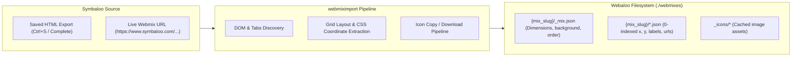

# webmiximport — User & Operations Guide

| Metadata Field | Value |
| :--- | :--- |
| **Document ID** | `WEBMIXIMPORT-UG-001` |
| **Version** | `1.0.0` |
| **Target Audience** | Users, Developers, System Administrators |
| **Companion Docs** | [webmiximport-sdi.md](webmiximport-sdi.md), [symbaloo-importer-spec.md](symbaloo-importer-spec.md), [user_guide.md](user_guide.md) |

---

## 1. Overview & Operational Mental Model

`webmiximport` is a standalone migration tool and library designed to import visual bookmarks and layout structures from **Symbaloo** into **Webaloo**.



### 1.1 Ingestion Modes

1. **Local Saved HTML Mode (Recommended for Private / Multi-tab mixes)**:
   - Symbaloo web applications use client-side authentication and dynamic rendering.
   - You can open your webmix in any browser, press `Ctrl+S` ("Webpage, Complete"), and pass the saved `.html` file directly to `webmiximport`.
   - Companion assets stored in `<name>_files/` are ingested instantly with zero external network traffic.
2. **Live HTTP URL Mode (Public or Authenticated)**:
   - Provide standard Symbaloo mix URLs (e.g., `https://www.symbaloo.com/home/mix/<id>`).
   - If the mix requires an active user session, pass session cookies via `--cookies "<cookie_string>"` or the `SYMBALOO_COOKIES` environment variable.

---

## 2. Command Line Interface Reference

You can invoke `webmiximport` either directly via `uv run -m webmiximport` or through the Webaloo CLI command `uv run webaloo import-symbaloo`.

### 2.1 Synopsis

```powershell
uv run -m webmiximport <source> [OPTIONS]
# or
uv run webaloo import-symbaloo <source> [OPTIONS]
```

### 2.2 Options & Flags

| Flag / Option | Description | Default |
| :--- | :--- | :--- |
| `<source>` | **Required**. Path to local HTML file, `file://` URI, or remote Symbaloo URL. | — |
| `--dir <path>` | Destination root directory for Webaloo webmixes (overrides `WEBALOO_DIR`). | `./webmixes` |
| `--list` | Lists all webmix references discovered in the navigation tab bar and exits. | `false` |
| `--all` | Imports all webmixes discovered from the page tabs (fetches remote mixes via GraphQL). | `false` |
| `--cookies <val>` | Cookie string (`"session_id=...; user_id=..."`) or path to a text file containing cookies. | `$env:SYMBALOO_COOKIES` |
| `--header <H>` | Additional HTTP header in `"Key: Value"` format (repeatable). | `[]` |
| `-h`, `--help` | Display the command help message and exit. | — |

---

## 3. Practical Usage Scenarios

### 3.1 Discovering Available Webmixes (`--list`)

When viewing a saved Symbaloo page or live URL that contains multiple webmix tabs, discover all linked webmixes:

```powershell
uv run -m webmiximport "path/to/exported-page.html" --list
```

**Example Output:**
```text
Discovered 4 webmix(es) in 'path/to/exported-page.html':

#   Status    Title                          URL
--------------------------------------------------------------------------------
1   [ACTIVE]  Daily Bookmarks                https://www.symbaloo.com/home/mix/<mix-id-1>
2             Work Projects                  https://www.symbaloo.com/home/mix/<mix-id-2>
3             Reading List                   https://www.symbaloo.com/home/mix/<mix-id-3>
4             Tools & Utilities              https://www.symbaloo.com/home/mix/<mix-id-4>
...
```

### 3.2 Importing from a Saved HTML Export

1. Open your Symbaloo dashboard in Google Chrome, Firefox, or Edge.
2. Select your desired webmix tab and press `Ctrl+S` (Save As). Choose **Webpage, Complete**.
3. Run the importer:
   ```powershell
   uv run -m webmiximport "C:\Users\User\Downloads\Symbaloo.html"
   ```

**Example Summary:**
```text
=== Symbaloo Import Summary ===
Target Slug:       daily-bookmarks
Webmix Title:      Daily Bookmarks
Grid Dimensions:   10 x 6
Total Tiles:       52
Cached Icons:      52
Monograms Used:    0
Saved Directory:   ./webmixes/daily-bookmarks
```

### 3.3 Importing into a Custom Directory

```powershell
uv run -m webmiximport "path/to/exported-page.html" --dir "C:\Dev\my-custom-webmixes"
```

### 3.4 Live Import with Browser Session Cookies

For webmixes behind a login wall:

1. In DevTools (`F12`), go to **Network** or **Application > Storage > Cookies**, and copy the cookie header value.
2. Pass it directly on the command line:
   ```powershell
   uv run -m webmiximport "https://www.symbaloo.com/home/mix/<mix-id>" --cookies "SESSION=<session-token>; remember-me-2=<remember-token>; SRV=<srv-id>"
   ```
   Or set the environment variable:
   ```powershell
   $env:SYMBALOO_COOKIES = "SESSION=<session-token>; remember-me-2=<remember-token>; SRV=<srv-id>"
   uv run -m webmiximport "https://www.symbaloo.com/home/mix/<mix-id>"
   ```

### 3.5 Importing All Webmixes in One Shot (`--all`)

To import the active webmix along with every other webmix tab discovered in the navigation bar:

```powershell
uv run -m webmiximport "path/to/exported-page.html" --all --cookies "SESSION=<session-token>; remember-me-2=<remember-token>; SRV=<srv-id>"
```

**Example Summary:**
```text
=== Symbaloo Import Summary (All Webmixes: 4) ===
- [OK] Daily Bookmarks (daily-bookmarks): 52 tiles, 10x6 grid -> ./webmixes/daily-bookmarks
- [OK] Work Projects (work-projects): 14 tiles, 10x6 grid -> ./webmixes/work-projects
- [OK] Reading List (reading-list): 28 tiles, 10x6 grid -> ./webmixes/reading-list
- [OK] Tools & Utilities (tools-utilities): 18 tiles, 10x6 grid -> ./webmixes/tools-utilities
...
```

---

## 4. Output Artifacts & Verification

After importing, verify the results directly in the filesystem or in the Webaloo web application:

1. **Check Directory Layout**:
   - Webmix configuration: `./webmixes/<slug>/_mix.json`
   - Individual tiles: `./webmixes/<slug>/<tile-id>.json`
   - Extracted icons: `./webmixes/_icons/`
2. **Coordinate & Collision Safety**:
   - Duplicate tile titles within the same webmix are safely suffixed (e.g. `bookmark.json`, `bookmark-2.json`).
   - If an imported webmix slug already exists, the webmix directory receives an incrementing suffix (e.g. `daily-bookmarks-2/`).
3. **Open Webaloo**:
   ```powershell
   uv run webaloo
   ```
   Visit `http://127.0.0.1:8080/` in your browser. The newly imported webmix will appear as a selectable tab in the navigation bar.

---

## 5. Troubleshooting & Diagnostics

| Symptom | Root Cause | Resolution |
| :--- | :--- | :--- |
| `HTTP 401: Access denied` | Webmix requires user login. | Export page locally via `Ctrl+S` or pass session cookies using `--cookies`. |
| `Could not find a Symbaloo grid container` | Input file is not a valid Symbaloo page or was saved before the grid finished rendering. | Ensure the page is completely loaded in the browser before saving as "Webpage, Complete". |
| Icons show as monograms | Local companion folder (`<name>_files/`) was deleted or moved. | Keep the companion files folder adjacent to the `.html` file when moving exports. |
